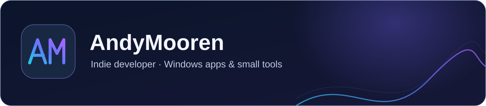

Делаю приложения для Windows и небольшие инструменты автоматизации. Работаю с Python, иногда пишу на Java и собираю веб-интерфейсы для своих проектов.

Сейчас основной проект здесь: **[Насквозь](https://github.com/RedTowerInc/naskvoz)**. Это программа для подбора локального обхода DPI под YouTube и Discord. Готовую Windows-версию можно [скачать в Releases](https://github.com/RedTowerInc/naskvoz/releases/latest).

По вопросам, багам и предложениям пишите в Telegram: **[@AndyMooren](https://t.me/AndyMooren)**.
